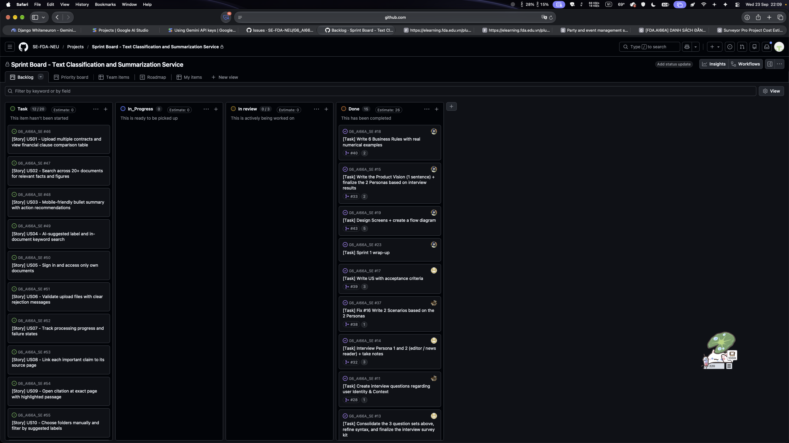
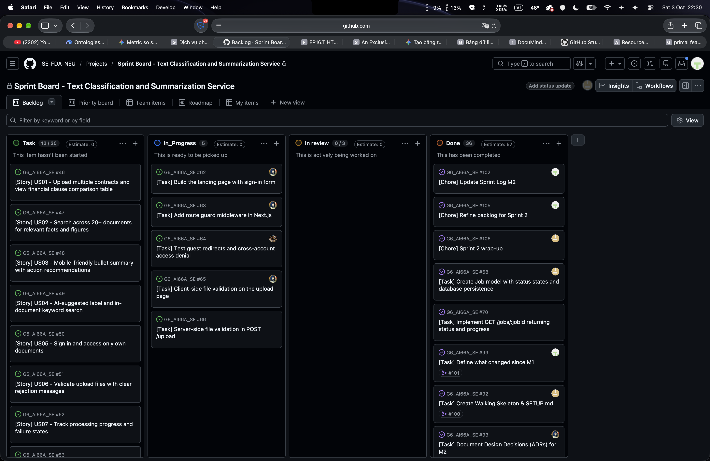
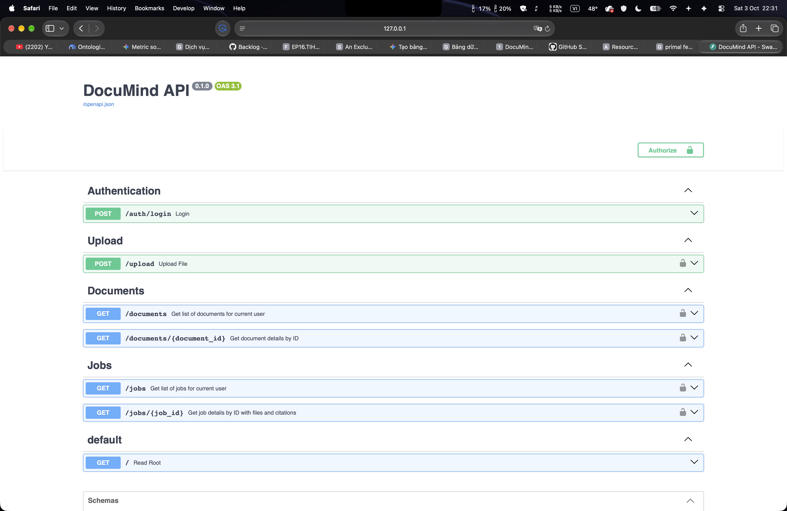
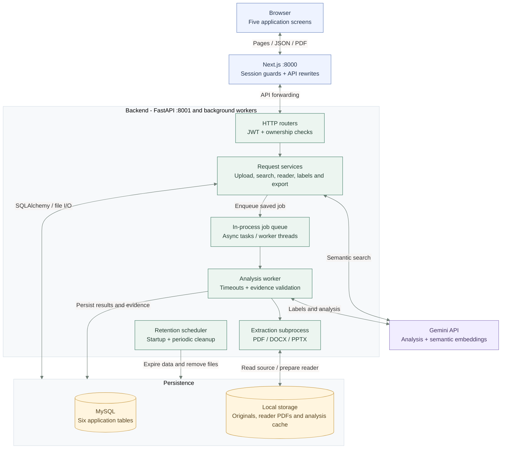
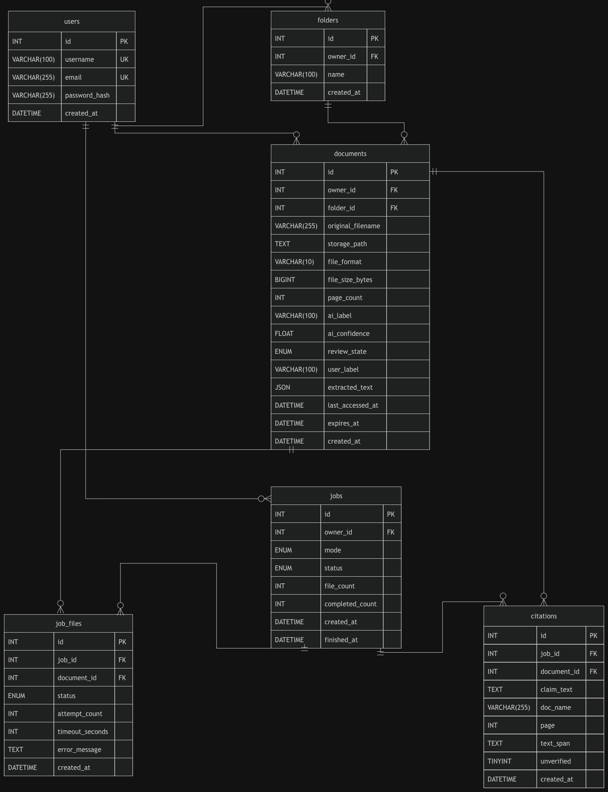
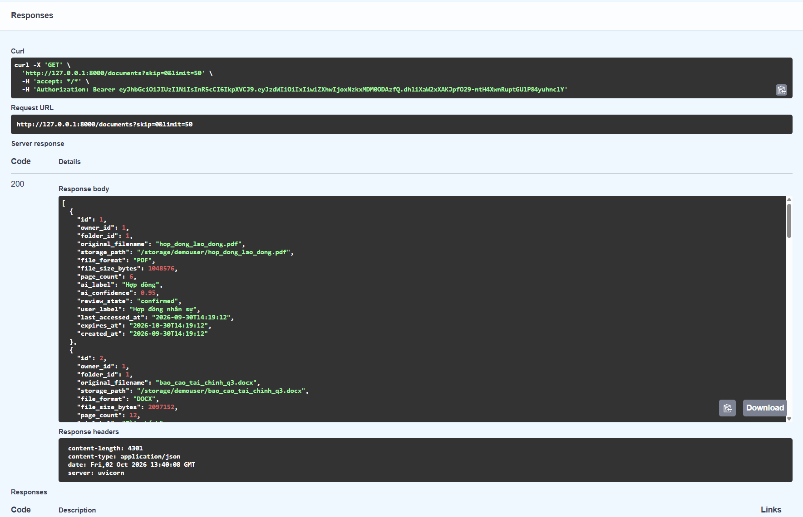
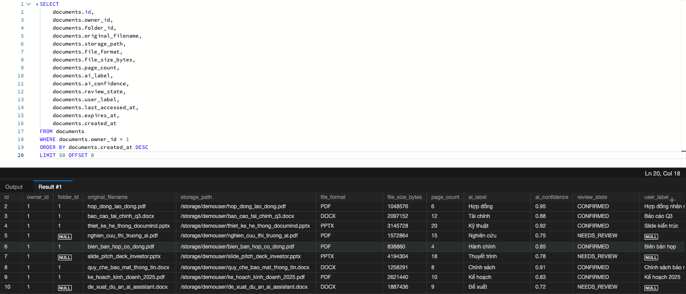

# DocuMind — System Design

```
Team:           Team 06 — DocuMind
Topic:          C2
Members:        To Hien Hai Dang (11247271), Phan Dang Vu (11247373),
                Bui Dang Duong (11247274), Nguyen Bao Tai (11247348)
Product Owner:  @PhanDangVu
Scrum Master:   @duongbui0811       (Sprint 2 — must differ from Sprint 1)

Repository:     https://github.com/SE-FDA-NEU/G6_AI66A_SE.git
Project board:  https://github.com/orgs/SE-FDA-NEU/projects/24
Setup guide:    https://github.com/SE-FDA-NEU/G6_AI66A_SE/blob/main/docs/SETUP.md

Submitted by:   Phan Dang Vu
```


## Project board screenshots

### After Sprint Planning (Sep 22)



### On submission day (Oct 5)




## Walking skeleton running




---

## 3.1 Architecture

The browser uses Next.js on port 8000; Next.js forwards API calls to FastAPI on port 8001. FastAPI owns authentication, document access, background processing and persistence.



Editable source: [architecture.mmd](architecture.mmd).

- **Processing:** uploads return a saved job ID immediately; the in-process queue runs extraction, Gemini analysis and evidence validation in the background. Results are stored in MySQL and polled by the interface.
- **Sources:** original files and immutable reader PDFs stay on local storage. PDF uses source pages; DOCX uses generated reader pages and PPTX uses one reader page per slide. Cached analysis and saved summaries avoid repeated model calls.
- **Operations:** `run.py` prepares the database before starting both servers. Retention cleanup starts with FastAPI. The queue drains on graceful shutdown but has no durable broker or crash recovery.

## 3.2 Data model

### ERD (Entity Relationship Diagram)



---


## Table definitions

| Table         | Columns                                                                                                                                                                                                                                                                                                                           | Constraint · which M1 rule                                                                                                                                                                                                                                                                                                                                                                                                                                           |
| ------------- | --------------------------------------------------------------------------------------------------------------------------------------------------------------------------------------------------------------------------------------------------------------------------------------------------------------------------------- | -------------------------------------------------------------------------------------------------------------------------------------------------------------------------------------------------------------------------------------------------------------------------------------------------------------------------------------------------------------------------------------------------------------------------------------------------------------------- |
| **users**     | `id` PK · `username` UNIQUE · `email` UNIQUE · `password_hash` · `created_at`                                                                                                                                                                                                                                                     | `username`, `email`, and `password_hash` are required. Authentication identifies the owner of protected data; document and job access must be checked against that owner. **BR07**                                                                                                                                                                                                                                                                                   |
| **folders**   | `id` PK · `owner_id` FK → `users.id` · `name` · `created_at`                                                                                                                                                                                                                                                                      | `owner_id` and `name` are required. Only the owner may create or manage a folder. Folder placement is always chosen by the user; an AI label must not create or move a folder. **BR03, BR07**                                                                                                                                                                                                                                                                        |
| **documents** | `id` PK · `owner_id` FK → `users.id` · `folder_id` FK → `folders.id` NULL · `original_filename` · `storage_path` · `file_format` · `file_size_bytes` · `page_count` NULL · `ai_label` NULL · `ai_confidence` NULL · `review_state` · `user_label` NULL · `extracted_text` NULL · `last_accessed_at` · `expires_at` · `created_at` | `owner_id`, file metadata, and retention timestamps are required. Format is PDF/DOCX/PPTX and each file is at most 5 MB; validate before insert. `folder_id` may stay NULL and may only reference the same owner's folder. Keep AI suggestion/confidence separate from the user label and folder; below 80% confidence, show Needs review. Set expiry to 30 days after last access and warn seven days before deletion. **BR01, BR03, BR06, BR07**                   |
| **jobs**      | `id` PK · `owner_id` FK → `users.id` · `mode` · `status` · `file_count` · `completed_count` · `result_data` NULL · `created_at` · `finished_at` NULL                                                                                                                                                                              | A submission has at most five files and at most 50 MB combined; check these limits before creating a job. `mode` is `bullet`, `table`, or `concept`. Track progress from `pending` to a terminal status; a five-contract table has a five-minute target and a 15-page bullet summary has a three-minute target. Limit a general summary to 1,000 words and a concept overview to three to five concepts. Only the owner may read the job. **BR01, BR02, BR04, BR07** |
| **job_files** | `id` PK · `job_id` FK → `jobs.id` · `document_id` FK → `documents.id` · `status` · `attempt_count` · `timeout_seconds` NULL · `error_message` NULL · `created_at`                                                                                                                                                                 | One row links one document to one processing job. The job and document must belong to the same user. Preserve each file's progress and failure state so a failed item is not reported as completed. **BR02, BR07**                                                                                                                                                                                                                                                   |
| **citations** | `id` PK · `job_id` FK → `jobs.id` · `document_id` FK → `documents.id` · `claim_text` · `doc_name` · `page` NULL · `text_span` NULL · `unverified` · `created_at`                                                                                                                                                                  | The citation's job and document must share an owner. A verified amount, date, percentage, or clause needs a source document and page; if the source cannot be located, set `unverified = true` and show Unverified. `text_span` supports highlighting when available. **BR05, BR07**                                                                                                                                                                                 |

---

## 3.3 API design

This inventory covers all **22 application endpoints** registered in `backend/app/main.py`, plus FastAPI's generated documentation routes. Paths below are backend paths on **http://127.0.0.1:8001**.

### Authentication and shared conventions

Protected endpoints accept either `Authorization: Bearer <JWT>` or the `documind_session` HttpOnly cookie. `POST /auth/login`, `POST /auth/logout`, `GET /` and the generated documentation routes are public; all other operations require authentication (**BR07**).

- Protected calls return **401** for a missing/invalid session. Invalid parameters or request bodies return **422**. Endpoint-specific errors are listed below.
- Errors use FastAPI's `{"detail": ...}` envelope: a string, a validation-error list or a structured object containing `code` and `message`.
- `DocumentResponse` contains file metadata, AI/user labels, confidence, folder and retention timestamps; it excludes extracted page text. `JobResponse` contains status, counts, timestamps and saved `result_data`.
- Query parameters marked `?` are optional. IDs are integers; page numbers are one-based. Time fields use UTC.

### Authentication

| Method | Endpoint | Request | Success response | Other errors |
|---|---|---|---|---|
| POST | `/auth/login` | URL-encoded form: `username` (email or username), `password`. | **200**: `access_token`, `token_type`; sets the session cookie. | **401** incorrect credentials. |
| GET | `/auth/me` | Session cookie or Bearer token. | **200**: current user's `id`, `username`, `email`. | **401** invalid session or missing user. |
| POST | `/auth/logout` | No body. | **204**: clears the session cookie; safe without an active session. | None specific. |

### Upload and jobs

| Method | Endpoint | Request | Success response | Other errors |
|---|---|---|---|---|
| POST | `/upload` | Multipart: repeated `files`; `mode=bullet` by default (`bullet`, `table`, `concept`); `language=vi` by default (`en` or `vi`). | **202**: `{"jobId":"123"}`; processing continues in the background. | **422** invalid batch/mode/language; **500** storage or database failure; **503** enqueue failure. |
| GET | `/jobs` | Query: `status?`, `mode?`, `skip=0`, `limit=50` (1-100). | **200**: current user's `JobResponse[]`. | **422** invalid filters/pagination. |
| GET | `/jobs/{job_id}` | Path: `job_id`. | **200**: job metadata, `result_data`, `job_files` and `citations`. | **404** missing job or job owned by another user. |
| GET | `/jobs/{job_id}/export.pdf` | Path: `job_id`; optional header `X-DocuMind-Language: en` or `vi`. | **200**: downloadable `application/pdf` comparison table. Saved job language takes precedence over the header. | **404** missing/not-owned job; **409** incomplete table, unavailable source or unsuitable result. |

Job/file statuses are `pending`, `processing`, `completed`, `failed` and `timed_out`. The Results screen polls job details every three seconds until completion/failure. Analysis is stored per document in `result_data.documents`; reading results does not invoke Gemini.

### Document metadata and organization

| Method | Endpoint | Request | Success response | Other errors |
|---|---|---|---|---|
| GET | `/documents` | Query: `folder_id?`, `unassigned=false`, `label?`, `ai_label?`, `review_state?`, `search?`, `filename?`, `skip=0`, `limit=50` (1-100). | **200**: owned, available `DocumentResponse[]`; filters apply before pagination. | **422** invalid/conflicting labels or pagination. |
| GET | `/documents/{document_id}` | Path: `document_id`. | **200**: `DocumentResponse`; renews retention. | **403** another owner's document; **404** missing; **410** expired source. |
| PATCH | `/documents/{document_id}/label` | JSON: `user_label?` (1-100 characters or null), `review_state?` (`confirmed` or `needs_review`); at least one field. | **200**: updated `DocumentResponse`; preserves AI label/confidence and folder. | **404** missing/not-owned document; **410** expired; **422** invalid or empty confirmation. |
| PATCH | `/documents/{document_id}/folder` | JSON: required `folder_id` (positive integer or null to unfile). | **200**: updated `DocumentResponse`; preserves label metadata. | **403** document/folder owned by another user; **404** missing document/folder; **410** expired source. |

`filename` matches a literal filename substring. `label` and its alias `ai_label` match the AI suggestion exactly, including case/accents; supplying both requires equal values. `search` matches filename, AI label or user label. List requests do not renew retention.

### Reader, source files and saved summaries

| Method | Endpoint | Request | Success response | Other errors |
|---|---|---|---|---|
| POST | `/documents/{document_id}/reader` | Path: `document_id`; no body. | **200**: `{"page_count":N}`; prepares/persists the reader representation. | **403** not owned; **404** missing; **410** expired; **422** extraction/conversion failure. |
| GET | `/documents/{document_id}/pages` | Path: `document_id`. | **200**: pages with text/positions, `page_count`, `page_kind`, `reader_layout`, `reader_version`, `reader_url` and document metadata. | **403** not owned; **404** missing; **409** reader not ready or invalid; **410** expired. |
| GET | `/documents/{document_id}/pages/{page}/text` | Path: `document_id`, `page`. | **200**: `document_id`, `page`, `text`, `positions`. | **403** not owned; **404** missing document/page/text; **410** expired. |
| GET | `/documents/{document_id}/reader.pdf` | Required query: `version` (reader SHA-256). Optional: `highlight_page?`, `q?`, `start?`, `end?`. | **200**: inline `application/pdf`; optional highlights; `X-Reader-Version` header. | **403** not owned; **404** missing document; **409** unavailable/changed reader; **410** expired; **422** invalid highlight page/range. |
| GET | `/documents/{document_id}/summary` | Path: `document_id`; query: `job_id?` (positive integer). | **200**: latest matching completed `{job_id, created_at, mode, document}`, or `document: null` when no result exists. | **403** not owned; **404** missing document; **410** expired. |
| GET | `/documents/{document_id}/file` | Path: `document_id`; query: `page?`, `rendered=false`. | **200**: original file, or reader PDF when `rendered=true`; file/page metadata headers. `page` sets `X-Initial-Page`. | **403** not owned; **404** missing document/file; **409** reader unavailable; **410** expired; **422** page outside document. |
| GET | `/documents/{document_id}/rendered-file` | Path: `document_id`; query: `page?`. | **200**: PDF; alias of `/file?rendered=true`. | Same errors as `/file`. |

Reader PDFs are versioned against the exact displayed bytes. Highlight requests require `highlight_page` when using `q` or offsets. DOCX citations use generated text-reader pages; PPTX citations use slide numbers. Successful source opens/downloads and document updates renew retention; listing documents and polling jobs do not.

### Folders and search

| Method | Endpoint | Request | Success response | Other errors |
|---|---|---|---|---|
| GET | `/folders` | Query: `skip=0`, `limit=100` (1-100). | **200**: current user's `FolderResponse[]`: `id`, `owner_id`, `name`, `created_at`. | **422** invalid pagination. |
| POST | `/folders` | JSON: `name` (1-100 nonblank characters). | **201**: created `FolderResponse`. | **422** invalid name or unexpected fields. |
| GET | `/search` | Required query: `q` (1-500 characters). Optional: `mode=content` (`content` or `semantic`), `folder_id?`, `label?`, `offset=0`, `limit=20` (1-100). | **200**: `query`, `total_hits`, ranked `hits[]` with document/page, snippet, offsets, reader version and highlight URL. | **422** invalid/blank query/filter; **503** embedding unavailable or rate-limited; `Retry-After` for quota limits. |

Content search matches normalized query terms against stored page passages. Semantic search uses Gemini embeddings. Search's `label` filter is case-insensitive and uses the user label when present, otherwise the AI label; it differs from the exact AI-label filter on `/documents`.

### Service and generated documentation routes

| Method | Endpoint | Purpose / response |
|---|---|---|
| GET | `/` | **200**: `{"message":"Welcome to DocuMind API"}`. |
| GET, HEAD | `/openapi.json` | Generated OpenAPI schema. |
| GET, HEAD | `/docs` | Swagger UI. |
| GET, HEAD | `/docs/oauth2-redirect` | Swagger OAuth2 redirect helper. |
| GET, HEAD | `/redoc` | ReDoc API reference. |

### Browser-to-backend routing

The browser uses the Next.js origin at **http://127.0.0.1:8000**. Rewrites in `frontend/next.config.mjs` forward these calls to `BACKEND_ORIGIN` (default `http://127.0.0.1:8001`).

| Browser API path | FastAPI path |
|---|---|
| `/auth/*` | `/auth/*` |
| `/jobs/*` | `/jobs/*` |
| `/api/upload` | `/upload` |
| `/api/search` | `/search` |
| `/api/folders` | `/folders` |
| `/api/documents/*` | `/documents/*` |

### Upload validation and background processing

`POST /upload` validates BR01 before saving a batch: PDF/DOCX/PPTX only, 1-5 files, at most 5 MB each and 50 MB combined; 1 MB = 1,048,576 bytes. It counts actual bytes, saves randomly named files and creates the pending Job/Document/JobFile records in one transaction. Persistence failures roll back the transaction and remove the new batch's files. Enqueue failures mark the saved job failed.

The queue runs `services/processing.py` in a worker thread. A cancellable subprocess prepares reader pages, Gemini generates the selected output when configured, and validated results/evidence are persisted before publication. Without a Gemini key, results explicitly report `analysis_status: not_configured`. Per-file retries/timeouts and terminal states are saved independently of the request.

BR01 failures return **422** with this structure:

```json
{
  "detail": {
    "code": "upload_validation_failed",
    "batch_errors": [],
    "files": [
      {
        "index": 1,
        "filename": "malware.exe",
        "size_bytes": 16,
        "errors": [
          {"code": "invalid_format", "message": "Only PDF, DOCX and PPTX files are allowed."}
        ]
      }
    ]
  }
}
```

`index` is zero-based; only rejected files appear in `files`. Validation codes are `files_required`, `too_many_files`, `invalid_format`, `file_too_large` and `batch_too_large`. Batch-level errors also appear in `batch_errors`. Five valid files can total at most 25 MB, while the independent 50 MB guard still rejects oversized submissions.

---

## 3.4 Walking skeleton

> **Route:** `GET /documents` · **Table:** `documents` (40 rows seeded across 4 users, 10 documents per user)  
> **Source Repository:** `https://github.com/Dangtooo/G6_AI66A_SE.git`

---

### 1. Prerequisites

No pre-installed software is assumed. A fresh machine requires the following tools:

- **Git:** version `2.40+` ([Download Git](https://git-scm.com/))
- **Python:** version `3.11+` or `3.12+` (with `pip` and `venv`) ([Download Python](https://www.python.org/))
- **MySQL Server:** version `8.0+` (running on default port `3306`) ([Download MySQL](https://dev.mysql.com/downloads/installer/))

---

### 2. Setup Commands (Step-by-step)

Follow the commands in sequential order. Choose the command corresponding to your operating system.

> **Quick Reference (For Experienced Developers):**
>
> ```bash
> git clone https://github.com/Dangtooo/G6_AI66A_SE.git
> cd G6_AI66A_SE/backend
> python -m venv .venv
> .venv\Scripts\activate       # macOS / Linux: source .venv/bin/activate
> pip install -r requirements.txt
> copy .env.example .env       # macOS / Linux: cp .env.example .env
> # STOP & EDIT: Update DB_PASSWORD in backend/.env before continuing!
> python src/init_db.py
> uvicorn app.main:app --reload
> ```

### Step-by-Step Installation

```bash
# 1. Clone the repository
git clone https://github.com/Dangtooo/G6_AI66A_SE.git
cd G6_AI66A_SE/backend

# 2. Create Python virtual environment
python -m venv .venv

# 3. Activate the virtual environment:
# On Windows (Command Prompt or PowerShell):
.venv\Scripts\activate
# On macOS / Linux:
source .venv/bin/activate

# 4. Install dependencies
pip install -r requirements.txt

# 5. Create local environment configuration file:
# On Windows:
copy .env.example .env
# On macOS / Linux:
cp .env.example .env
```

> **CRITICAL: Configure `.env` before proceeding to database initialization!**  
> Do not execute database scripts yet. You **must** open `backend/.env` and update your MySQL password (`DB_PASSWORD`) in **[Section 3: Configuration (`.env`)](#3-configuration-env)** below before running the database seeding in Section 4. Otherwise, database initialization will fail with an authentication error.

---

### 3. Configuration (`.env`)

Open the newly created `backend/.env` file in your text editor and configure your local Database connection details:

> **Prerequisite for Database Initialization:**  
> The database script (`init_db.py`) relies on these credentials to connect to your local MySQL server and create `documind_db`. If `DB_PASSWORD` is incorrect or left as default, database initialization will fail.

| Environment Variable          | Sample / Default Value          | Description & Instructions                           |
| ----------------------------- | ------------------------------- | ---------------------------------------------------- |
| `DB_USER`                     | `root`                          | MySQL username on your machine                       |
| `DB_PASSWORD`                 | `your_mysql_password`           | **Required:** Set to your actual MySQL root password |
| `DB_HOST`                     | `localhost`                     | MySQL host address                                   |
| `DB_PORT`                     | `3306`                          | MySQL service port                                   |
| `DB_NAME`                     | `documind_db`                   | Database name (auto-created if not exists)           |
| `SECRET_KEY`                  | `super_secret_key_documind_123` | Secret key used to sign and decode JWT tokens        |
| `ALGORITHM`                   | `HS256`                         | JWT encryption algorithm                             |
| `ACCESS_TOKEN_EXPIRE_MINUTES` | `1440`                          | JWT token lifespan (1440 minutes = 24 hours)         |

---

### 4. Database Creation & Seeding

After configuring `.env` with your valid MySQL credentials, execute database creation, table schema generation, and sample data seeding with **a single command**:

```bash
python src/init_db.py
```

### Number of Seeded Rows:

- **`users`:** **4 rows** (`demouser`, `admin`, `testuser`, `guest` — default password: `123456`).
- **`folders`:** **4 rows** (each user owns 1 dedicated folder).
- **`documents`:** **40 rows** (each user has exactly **10 documents** across PDF, DOCX, and PPTX formats).
- **`jobs`:** **20 rows** (each user has 5 processing jobs across `bullet`, `table`, and `concept` modes).
- **`job_files`:** **32 rows** (associating jobs with documents).
- **`citations`:** **12 rows** (factual evidence and citations).

### Start the Backend Server

Once the database has been successfully initialized and seeded, start the FastAPI development server:


```bash
uvicorn app.main:app --reload
```

---

### 5. How to Know It Worked (Verification Guide)

The walking skeleton route is **`GET /documents`**. Because the system enforces Business Rule **BR07** (Users can only view their own documents), this route requires a Bearer JWT token.

### Verification Steps via Swagger UI:

1. Open your browser and navigate to:  
   **`http://localhost:8000/docs`**
2. **Log in to obtain a Token:**
   - Under `Authentication`, click on **`POST /auth/login`**.
   - Click **"Try it out"**, enter `username`: `demouser`, `password`: `123456`, then click **"Execute"**.
   - Copy the `access_token` string from the response body.
3. **Authorize:**
   - Scroll to the top of the Swagger UI page, click the green **Authorize ** button.
   - Paste the token into the **Value** field and click **Authorize**, then click **Close**.
4. **Call `GET /documents`:**
   - Under `Documents`, click on **`GET /documents`**.
   - Click **"Try it out"** > click **"Execute"**.

### Expected Response:

The server returns HTTP Status **`200 OK`** with exactly **10 documents** belonging to `demouser` (with `extracted_text` deferred to optimize payload):

```json
[
  {
    "id": 1,
    "owner_id": 1,
    "folder_id": 1,
    "original_filename": "hop_dong_lao_dong.pdf",
    "storage_path": "/storage/demouser/hop_dong_lao_dong.pdf",
    "file_format": "PDF",
    "file_size_bytes": 1048576,
    "page_count": 6,
    "ai_label": "Contract",
    "ai_confidence": 0.95,
    "review_state": "confirmed",
    "user_label": "Human resources contract",
    "last_accessed_at": "2026-09-30T14:00:00",
    "expires_at": "2026-10-30T14:00:00",
    "created_at": "2026-09-30T14:00:00"
  },
  {
    "id": 2,
    "owner_id": 1,
    "folder_id": 1,
    "original_filename": "bao_cao_tai_chinh_q3.docx",
    "storage_path": "/storage/demouser/bao_cao_tai_chinh_q3.docx",
    "file_format": "DOCX",
    "file_size_bytes": 2097152,
    "page_count": 12,
    "ai_label": "Tài chính",
    "ai_confidence": 0.88,
    "review_state": "confirmed",
    "user_label": "Báo cáo Q3",
    "last_accessed_at": "2026-09-30T14:00:00",
    "expires_at": "2026-10-30T14:00:00",
    "created_at": "2026-09-30T14:00:00"
  }
]
```

_(Or quickly test using a single cURL command)_:

```bash
curl -X GET "http://localhost:8000/documents?skip=0&limit=50" -H "Authorization: Bearer <TOKEN_FROM_LOGIN>"
```

### Screenshot of the Running Page:

The screenshot below demonstrates the running API endpoint on Swagger UI (`http://127.0.0.1:8000/documents?skip=0&limit=50`) returning HTTP `200 OK` with the seeded documents:



---

### 6. The Query Behind the Page (Query in `design.md`)

When a user calls `GET /documents`, SQLAlchemy generates the following equivalent SQL query (filtering by the authenticated user's `owner_id` and excluding `extracted_text` via `defer`):

```sql
SELECT
    documents.id,
    documents.owner_id,
    documents.folder_id,
    documents.original_filename,
    documents.storage_path,
    documents.file_format,
    documents.file_size_bytes,
    documents.page_count,
    documents.ai_label,
    documents.ai_confidence,
    documents.review_state,
    documents.user_label,
    documents.last_accessed_at,
    documents.expires_at,
    documents.created_at
FROM documents
WHERE documents.owner_id = 1
ORDER BY documents.created_at DESC
LIMIT 50 OFFSET 0;
```

### Screenshot of SQL Query and Fetched Data:

The screenshot below shows the executed query in the database client and the resulting records returned from the `documents` table:



---

### 7. Troubleshooting (Common Issues on Fresh Machines)

### Issue 1: `sqlalchemy.exc.OperationalError: Can't connect to MySQL server on 'localhost' ([WinError 10061])`

- **Cause:** The MySQL service is not running or the `DB_PASSWORD` in `.env` is incorrect.
- **Resolution:**
  - On Windows: Run PowerShell as Admin and execute `net start MySQL80` (or open `services.msc` > Start `MySQL80` service).
  - On macOS/Linux: Run `sudo systemctl start mysql` (or `brew services start mysql`).
  - Open `.env` and verify your `DB_PASSWORD`.

### Issue 2: `HTTP 401 Unauthorized` (`{"detail": "Not authenticated"}`)

- **Cause:** Called `GET /documents` without providing the `Authorization: Bearer <token>` header.
- **Resolution:**
  - Call `POST /auth/login` with `demouser` / `123456` to get a token.
  - On Swagger UI: Click the **Authorize ** button and paste the token.

### Issue 3: `ModuleNotFoundError: No module named 'app'`

- **Cause:** You are running commands from the `backend/app/` subdirectory instead of the `backend/` root directory.
- **Resolution:**
  - Run `cd ..` to return to the `backend/` directory, then re-run `uvicorn app.main:app --reload`.

---

### 8. Tested By (Independent Verification Log)

- **Tester:** `@hoang3003` (Team 3)
- **Environment:** Fresh Windows 11 Laptop (fresh clone)
- **Execution Time:** 2026-10-1 — **6 minutes**
- **Result:** Successfully executed all steps from clone to running the server and testing `GET /documents` on Swagger UI with 100% pass rate, returning exactly 10 documents for user `demouser`.

---

## 3.5 Architecture Decision Records

### Decision 1 - MySQL 8.x instead of SQLite or PostgreSQL

- **Options**: SQLite file · PostgreSQL in Docker · MySQL 8.x.
- **Chose**: MySQL 8.x.
- **Why**: SQLite's database-level lock would cause errors during concurrent writes from our background AI workers. PostgreSQL adds Docker complexity to the local setup and uses too much RAM for an AWS Free Tier server. MySQL provides the necessary row-level locking natively without the overhead.
- **What would change our mind**: If our app required complex JSONB analytics or geospatial queries that MySQL couldn't handle efficiently, we would move to PostgreSQL.

### Decision 2 — Tracking status in both `jobs` and `job_files`

- **Options**: Status in `jobs` only · Status in `job_files` only · Status in both.
- **Chose**: Status in both.
- **Why**: Our batch processing allows up to 5 files per job. Tracking status globally in jobs is needed for the overall UI progress bar, but tracking in `job_files` is strictly required to identify exactly which specific file failed and why.
- **What would change our mind**: If we disabled batch processing and restricted users to strictly one file per upload, `job_files` would become redundant and we would merge the status into the `documents` table.

## 3.6 What changed since M1

**Change 1 — Added `storage_path` to the documents table.**
M1 defined file upload rules (BR01) but did not specify where accepted files would be stored. Our first database draft stored file content as a BLOB column. During Sprint 2 we replaced it with a `storage_path TEXT` column so that files live on disk (or S3 in production) and the database stays small and fast.

**Change 2 — Created a dedicated `citations` table.**
M1's BR05 required every verified fact to link to a source document and page, but the data model was not yet designed. Our initial approach was to embed citations inside the `result_data` JSON column of the `jobs` table. We extracted them into a separate `citations` table with `claim_text`, `page`, `text_span` and `unverified` columns so that the frontend can query individual citations directly and the database can enforce referential integrity between citations, jobs and documents.

### Native Office reader (local)

DOCX/PPTX reader artifacts are generated in Python with python-docx/python-pptx and ReportLab. No external Office application is invoked. DOCX pagination belongs to the generated text-reader PDF, not Word's print layout. PPTX preserves one page per slide, including hidden/blank slides; speaker notes are excluded. Text/tables are available for evidence; source images/styles/layout are not reproduced. The pages API marks these artifacts with `reader_layout: text`; native PDFs and existing immutable reader artifacts retain their original representation. Glyph offsets are always computed from the exact displayed reader PDF.

### Local document library

The `/workspace` page organizes documents by folder: the sidebar changes locations, folder tiles open folders and document cards open the reader. The `?folder=<id>` parameter preserves the current location on reload or Back navigation. `?folder=unassigned` filters documents with `folder_id = null`; it does not represent a stored folder.

**Search by file name** filters the current location through the API before pagination. The `%` and `_` characters are treated as literal filename characters. **Search in document content** expands on demand, searches indexed excerpts across the library or an independently selected folder, and links to source pages. The optional **AI label filter** applies to the document cards. Label confirmation/editing and folder moves remain independent actions on each card.

On smaller screens, **Open folders** expands the navigation panel; selecting a location collapses it. The interface requires no database changes or additional external services.

### Semantic search embeddings and quotas

The current flow calls Gemini `batchEmbedContents` rather than running a local embedding model. Each `EmbedContentRequest` sends `taskType` and `outputDimensionality` directly so the service returns the configured 768 dimensions. During verification, placing these fields inside `embedContentConfig` caused the service to ignore them and return 3,072 dimensions, which failed vector validation.

The index is created on the first search and stored in the document's page JSON. Batches of up to 50 chunks are validated before storage. If a later batch reaches a quota limit, previously validated batches are still committed under the existing source lock. A retry sends only the missing chunks; invalid vectors are not stored. The API returns `embedding_rate_limited`, a `Retry-After` header and a Vietnamese message, keeping quota failures distinct from empty search results. The interface displays the waiting period, while keyword search remains available.

For queries in a language different from the source, a fixed 0.65 threshold can exclude all relevant passages. A Vietnamese query meaning "education" against English documents scored approximately 0.643 during verification. Ranking uses a 0.60 floor and retains passages within 0.025 of the highest score. Cosine similarity is a ranking measure, not the probability that an answer is correct. Coverage includes excluding weak neighboring matches, isolating accounts and searching English sources with Vietnamese queries.

### Reader PDF highlighting and saved summaries

The top of the reader continues to display the source PDF or the existing Office reader representation. In-document search and citation navigation send the page, query and character range to `GET /documents/{id}/reader.pdf`. The backend uses extracted glyph coordinates to highlight matches in yellow and the selected location in orange. The highlighted PDF is generated in memory; the original file and stored snapshot remain unchanged. Coordinates are normalized to the same page orientation before compositing, including PDFs with Rotate or CropBox settings. Scanned sources without glyph coordinates display a notice that precise highlighting is unavailable.

**Saved summary** appears below the PDF in place of the text-layer block. `GET /documents/{id}/summary` retrieves the document owner's most recent completed result from `jobs.result_data`, or the specified job's result when opened from that job. The interface reuses the existing bullet, concept or table presentation and preserves source citations. Opening a saved summary does not call Gemini again. Missing results, summary-loading failures and results from a different source version have separate messages and do not remove the reader.

### Interface language and AI output

The application uses a gettext-style React translation layer: `frontend/lib/i18n.js` provides `useI18n()` and `t(message, ...values)`, while `frontend/locales/messages.json` stores English and Vietnamese translations. Message placeholders use `{0}` and `{1}`. The **Language** selector in the bottom-right corner updates the page and saves the `documind_language` cookie. Server-rendered pages and the HTML language attribute use the selected language on reload.

During upload, the frontend sends `language=en|vi` with `files` and `mode`. Before queueing the job, the backend saves the language in `jobs.result_data.language`. The worker uses this value to request Gemini output directly in the selected language; server-generated limitation notices use that language as well. Each document result stores `language` alongside `output` in `jobs.result_data.documents`. No additional columns or database migration are required. Requests without a language default to Vietnamese.

Changing the interface language updates buttons, headings, statuses and messages. Saved summaries, AI labels, citations, filenames and user-entered content remain unchanged. Viewing results, reloading or exporting a PDF does not call AI for translation. Analysis prompts and cache entries distinguish languages, preventing Vietnamese results from being reused for English jobs. New-job PDFs use the saved language; older jobs use the interface language for PDF headings while retaining their saved content.


### Database preparation before local startup

`run.py` prepares the environment and runs `python -m app.db.bootstrap` with the backend's Python executable before starting the API and frontend processes. The module uses model metadata as the authoritative table list, creates the MySQL database if missing, backs up existing tables to SQL before making changes, creates missing tables and removes extra tables. Existing application tables are not rebuilt and their columns are not automatically deleted. A MySQL named lock prevents two launchers from synchronizing the same database concurrently. Foreign keys from retained tables or other databases into extra tables prevent their removal. `backend/src/init_db.py` uses the same preparation step before its separately requested seed operation.

Backups are stored in `backend/data/backups/`, which is excluded from Git. Schema synchronization does not seed or reset data/accounts and does not access Gemini.
