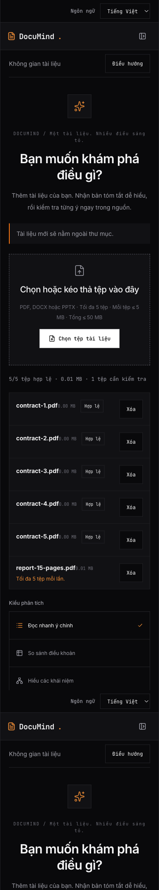

# v1.0 production acceptance — task #257

Status: **HOLD — not accepted, no tag/release created by this task.**
Prepared 2026-11-13. Coordinator: @PhanDangVu.

## Candidate and evidence

| Field | Verified value / remaining evidence |
|---|---|
| Public frontend | https://documind-web-k6i1.onrender.com |
| Public backend | https://documind-n9ny.onrender.com |
| Candidate main SHA | `0431a5d463295f6acd38b87c367e79c47a7037cc` |
| Successful candidate main CI | [43412489569](https://github.com/SE-FDA-NEU/G6_AI66A_SE/actions/runs/43412489569), all three jobs succeeded |
| Frontend deployed SHA / deploy ID | Pending Render Events evidence from Tai |
| Backend deployed SHA / deploy ID | Pending Render Events evidence from Dang |
| Browser/device/time | Pending private laptop and 375 px phone verification |
| Controlled restart evidence | Pending Dang/Duong; preserve DB and mounted files |
| Acceptance time UTC / reviewer | Pending; record only after all rows pass |
| Release tag | Pending acceptance and same-SHA deployment verification |

A successful main run proves checks passed for that SHA; it does not prove either
Render service is running it. Existing [public smoke evidence](evidence/m5/public-p0-254.md)
reports transport/ownership passes but a failed 3/5 batch and incomplete browser
acceptance. Issue closure does not replace those missing results. #269 modifies
analysis/key handling; its green CI does not establish live AI success.

## Live readiness probe (2026-11-13)

An unauthenticated HTTPS GET from this workspace returned **500 Internal Server
Error** for `https://documind-web-k6i1.onrender.com/health`; backend
`https://documind-n9ny.onrender.com/health` returned **200** with
`{"status":"ok","database":"ready"}`. This is a release blocker: Tai/Dang
must expose public app readiness with the required 200/503 behavior, deploy it
through green main and recheck. Backend readiness alone does not satisfy the
brief's `<public app URL>/health` requirement. No outage was induced.

## Follow-up verification (2026-11-13, 10:59–11:01 UTC)

PR #270 was approved by Dangtooo and merged. Main CI [43412489569](https://github.com/SE-FDA-NEU/G6_AI66A_SE/actions/runs/43412489569)
passed all three checks on the candidate SHA above (6 min 20 s).

The earlier frontend health failure did **not** reproduce after the service woke
up: both frontend and backend now return uncached 200 with DB ready. The public
landing initially showed Render's waking page and one health request timed out
at 50 seconds. Keep cold-start evidence separate from warmed readiness.

The [read-only smoke report](evidence/m5/production-readiness-257.json) records
11/11 passes: real application landing, both readiness endpoints, four guest
page redirects and four protected API 401 responses. Re-run from the repo root:
`node scripts/check-production.mjs /tmp/documind-readiness-unique.json`.
The output file must not already exist; failed checks produce exit code 1.
This checks public HTTP access, not deployment SHA or all P0 acceptance.

Browser checks used Orca's embedded browser with a newly registered synthetic
account, **not an independently verified private window or physical phone**:

| Check | Observed result |
|---|---|
| Start at landing → sign up → workspace | Passed with synthetic example.com account; `.invalid` email was rejected by registration validation |
| Session after browser reload | Workspace remained accessible; session cookie was not exposed through `document.cookie` |
| Mobile viewport | 375 × 812, document scroll width 375; desktop and mobile controls visible in their respective layouts |
| Six fixture PDFs through file picker | First five remained valid; sixth displayed “Tối đa 5 tệp mỗi lần.”; no analysis submitted |
| Seeded demo credentials from local SETUP | Login rejected; production demo credentials still required from owner |
| AI processing | Not run: new account has no Gemini key; UI requires a key and disables analysis |



Local follow-up: the production Playwright configuration now includes the
existing health-proxy regression (previously excluded). Production build/start
and this test passed, propagating the isolated backend's real 503 status/body
and `no-store` header. Backend `tests/test_health.py`: 5 passed, covering 200,
503, timeout, recovery and sanitized logs. Config node tests: 3 passed.

Render Dashboard currently shows sign-in; there is no authenticated deployment
session. The Render integration was found but its connection is pending user
sign-in. Repository permissions allow push/triage, not admin/maintain. Required
status checks, deploy IDs/SHAs, controlled restart/rollback, live AI, seeded
20-document acceptance and owner confirmations therefore remain unresolved.
No release tag has been created or moved.

## Public acceptance matrix

Start from the public landing page in private browsers, using ordinary test
accounts A and B and synthetic documents. Do not publish personal documents,
cookies, provider keys or real passwords. For each row record UTC time, input
filename/hash, job/document IDs, actual result, screenshot/log link and reviewer.
The full-story rows below remain pending. The narrower checks recorded above do not constitute full story acceptance.

| Story | Click path and checks | Required evidence / status |
|---|---|---|
| US01 #46 | Sign in → Upload → Table; five contracts; exact 0.05% daily penalty and source pages; ≤300 s or truthful failure | Pending; release requires successful real-AI five-file result |
| US02 #47 | Workspace → Search in ≥20 indexed owned documents; relevant snippets, names/pages, exclude unrelated facts; click page-6 result | Pending |
| US03 #48 | Upload → Bullet; 15-page PDF; ≤180 s; 375 px without horizontal scroll; ≥2 grounded actions or explicit source limitation | Pending |
| US04 #49 | Upload → Concept; 3–5 grounded concepts; reader keyword search/highlight; 87% label and 72% Needs review without moving folders | Pending; use controlled fixtures separately for exact confidence boundaries; do not claim random live confidence equals those fixtures |
| US05 #50 | Guest guards; sign in/out/reload; A sees only A; B denied A document, original, rendered source, result and export | Pending |
| US06 #51 | Upload five valid files near 5 MiB; sixth rejected without removing valid files; 5.1 MiB/EXE rejected with reason; server also rejects | Pending; include PDF/DOCX/PPTX |
| US07 #52 | Upload → Results; visible 3/5 progress; success persists on revisit; failed/timed-out files never look complete | Pending |
| US08 #53 | Results/search → citation; verify 8.2% against original; unsupported number Unverified; two sources retain separate references | Pending |
| US09 #54 | Citation → exact page 12 of 24 with highlight → Back to Results returns same job; image-only page explains unavailable highlighting | Pending |
| Persistence | F5 and fresh session preserve records/results/sources; controlled backend restart retains completed jobs and citations | Pending |
| Restart during work | Capture partial job, stop old process tree, start one replacement against same DB/storage; unfinished work fails with reupload guidance, new upload works | Pending; coordinate a maintenance window and do not interrupt unrelated work |
| Public readiness | Frontend `/health` and backend `/health` return 200 with DB ready; isolated DB failure yields 503 without secrets | Pending; do not disable the production DB to test failure |
| Release gate/rollback | Prove red CI cannot deploy in controlled environment; restore previous compatible frontend/backend SHA; smoke auth/DB/source files | Pending #252 evidence |

Use [existing fixtures and case mapping](testing.md), [public smoke script](evidence/m5/p254/public-smoke.mjs)
and [frontend acceptance guide](deploy-frontend-render.md). The existing smoke
script is diagnostic and does not assert all outcomes or exit nonzero for every
failure; its zero exit status is not acceptance. It creates accounts/uploads and
uses real provider quota. Review actual job/results, including all five files.

## Release procedure

1. Merge the reviewed changes through a PR. Obtain a teammate approval and all
   three successful CI jobs. Require those checks in the main organization ruleset;
   save the settings screenshot. Never bypass checks.
2. Select the **merged main SHA**, wait for its green CI, then deploy precisely
   that SHA to both Render services. Confirm Events SHA/deploy IDs, CI gate and
   stop-before-start single-worker backend behavior. Refresh the candidate table.
3. Complete every row above through public HTTPS. Record real provider execution,
   screenshots, timings, persistence and rollback evidence. Re-test failures after
   fixes on the new deployed SHA; stale evidence cannot approve changed behavior.
4. Dang, Duong and Tai verify their service/data details in [operations](operations.md).
   Vu records final acceptance time/reviewer and availability commitment.
5. Check remote `v1.0` before creating anything: `git ls-remote --tags origin
   refs/tags/v1.0 'refs/tags/v1.0^{}'`. If it exists, compare its peeled commit to
   the accepted SHA. Never delete, force-push or silently move an existing tag.
6. Only after acceptance, fetch main and create an annotated `v1.0` tag on the
   exact accepted SHA, push that tag, and publish the three-line release notes
   below. Verify the remote tag and both deployed SHAs again. Record release URL.

```text
DocuMind v1.0: nine P0 document workflows on public HTTPS with source citations.
Released from green main <accepted SHA>; CI <run URL>; accepted <UTC time>.
App https://documind-web-k6i1.onrender.com; operations docs/operations.md.
```

Code rollback redeploys the previous compatible pair; data restoration is a
separate coordinated MySQL/files operation. See operations for quiescing writes,
separate restore rehearsal and schema compatibility. Do not use `git reset` or
force-push main as a rollback mechanism.
