# DocuMind Milestone 3 UI

Team 06 - Topic C2. This document covers the five screens supporting P0 stories US01-US09. See [SETUP.md](SETUP.md) to run the application and [traceability.md](traceability.md) for story, PR and rule mappings.

### Sprint 3 board

The team supplied these Start and End board captures.

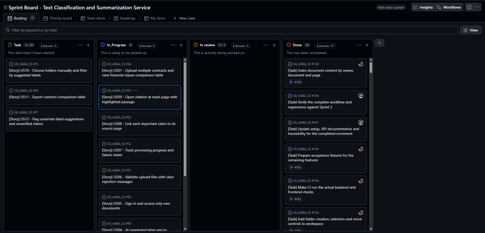

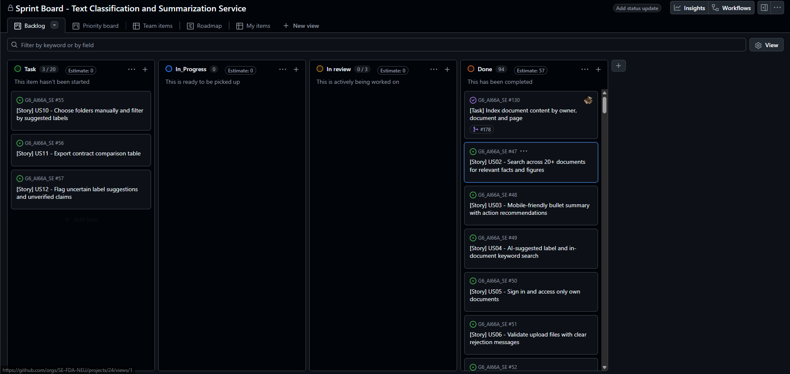

## 1. P0 stories and screen flow

`Implemented` means the route and supporting code exist. Acceptance remains subject to the [Definition of Done](definition-of-done.md). The team supplied the running-app screenshots below; no automated tests were rerun for this documentation update. Issue links refer to the implementation tasks listed in the M3 PDF.

| Story | Screen(s) | Route | Status | Issue |
|---|---|---|---|---|
| US01 Compare five contracts | Upload, Results, Reader | `/upload` -> `/results/:jobId` -> `/documents/:documentId` | Implemented | [#124](https://github.com/SE-FDA-NEU/G6_AI66A_SE/issues/124), [#125](https://github.com/SE-FDA-NEU/G6_AI66A_SE/issues/125), [#126](https://github.com/SE-FDA-NEU/G6_AI66A_SE/issues/126) |
| US02 Search across at least 20 documents | Workspace, Reader | `/workspace` -> `/documents/:documentId?page=6` | Implemented | [#130](https://github.com/SE-FDA-NEU/G6_AI66A_SE/issues/130), [#131](https://github.com/SE-FDA-NEU/G6_AI66A_SE/issues/131), [#132](https://github.com/SE-FDA-NEU/G6_AI66A_SE/issues/132), [#145](https://github.com/SE-FDA-NEU/G6_AI66A_SE/issues/145) |
| US03 Mobile bullet summary and actions | Upload, Results | `/upload` -> `/results/:jobId` | Implemented | [#127](https://github.com/SE-FDA-NEU/G6_AI66A_SE/issues/127), [#128](https://github.com/SE-FDA-NEU/G6_AI66A_SE/issues/128), [#129](https://github.com/SE-FDA-NEU/G6_AI66A_SE/issues/129) |
| US04 AI label, concept overview and in-document search | Upload, Workspace, Results, Reader | `/upload`, `/workspace`, `/results/:jobId`, `/documents/:documentId` | Implemented | [#119](https://github.com/SE-FDA-NEU/G6_AI66A_SE/issues/119), [#120](https://github.com/SE-FDA-NEU/G6_AI66A_SE/issues/120), [#121](https://github.com/SE-FDA-NEU/G6_AI66A_SE/issues/121), [#122](https://github.com/SE-FDA-NEU/G6_AI66A_SE/issues/122), [#123](https://github.com/SE-FDA-NEU/G6_AI66A_SE/issues/123) |
| US05 Sign in and protect the workspace | Login, all protected screens | `/` -> `/workspace`; protected `/upload`, `/results/:jobId`, `/documents/:documentId` | Implemented | [#62](https://github.com/SE-FDA-NEU/G6_AI66A_SE/issues/62), [#63](https://github.com/SE-FDA-NEU/G6_AI66A_SE/issues/63), [#64](https://github.com/SE-FDA-NEU/G6_AI66A_SE/issues/64) |
| US06 Reject invalid uploads | Upload | `/upload` | Implemented | [#65](https://github.com/SE-FDA-NEU/G6_AI66A_SE/issues/65), [#66](https://github.com/SE-FDA-NEU/G6_AI66A_SE/issues/66) |
| US07 Processing progress and failures | Upload, Results | `/upload` -> `/results/:jobId` | Implemented | [#69](https://github.com/SE-FDA-NEU/G6_AI66A_SE/issues/69), [#71](https://github.com/SE-FDA-NEU/G6_AI66A_SE/issues/71), [#72](https://github.com/SE-FDA-NEU/G6_AI66A_SE/issues/72), [#73](https://github.com/SE-FDA-NEU/G6_AI66A_SE/issues/73) |
| US08 Factual claims link to source pages | Results, Reader | `/results/:jobId` -> `/documents/:documentId` | Implemented | [#112](https://github.com/SE-FDA-NEU/G6_AI66A_SE/issues/112), [#114](https://github.com/SE-FDA-NEU/G6_AI66A_SE/issues/114) |
| US09 Correct page, highlight and return | Results, Reader | `/documents/:documentId?page=N&start=S&end=E&evidence=ID&job=J` | Implemented | [#115](https://github.com/SE-FDA-NEU/G6_AI66A_SE/issues/115), [#117](https://github.com/SE-FDA-NEU/G6_AI66A_SE/issues/117), [#118](https://github.com/SE-FDA-NEU/G6_AI66A_SE/issues/118) |

### Screen flow

Only P0 stories US01-US09 appear in this diagram. Solid arrows represent navigation/actions; dotted arrows represent guest redirects. The screen flow excludes P1 folder management, label editing and export actions.

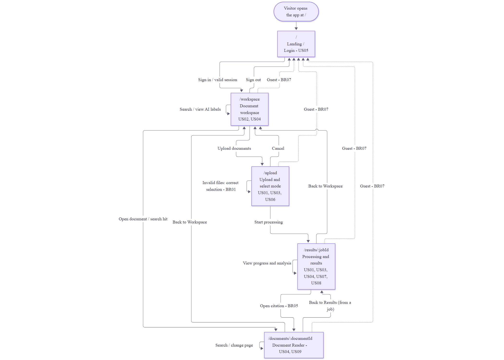

Editable source: [screen-flow.mmd](screen-flow.mmd).

Main path: Login -> Workspace -> Upload -> Results -> Reader. Workspace documents and search hits also open Reader. Back to Results returns to the originating job; back/cancel links return to Workspace. Guests opening a protected screen return to Login.

## 2. Wireframes

The following screenshots show the implemented P0 screens in the running application, including all four Workspace states. The application supports Vietnamese and English, as shown in the captures. API paths below refer to FastAPI; Next.js forwards browser requests through its configured rewrites.

### Login - `/`

The user comes here to understand DocuMind and sign in. A valid session opens Workspace. Failed sign-in stays on the form with an error; submission disables repeated clicks.

API calls:

- `POST /auth/login` - Sign in.
- `GET /auth/me` - Check the session on the server.

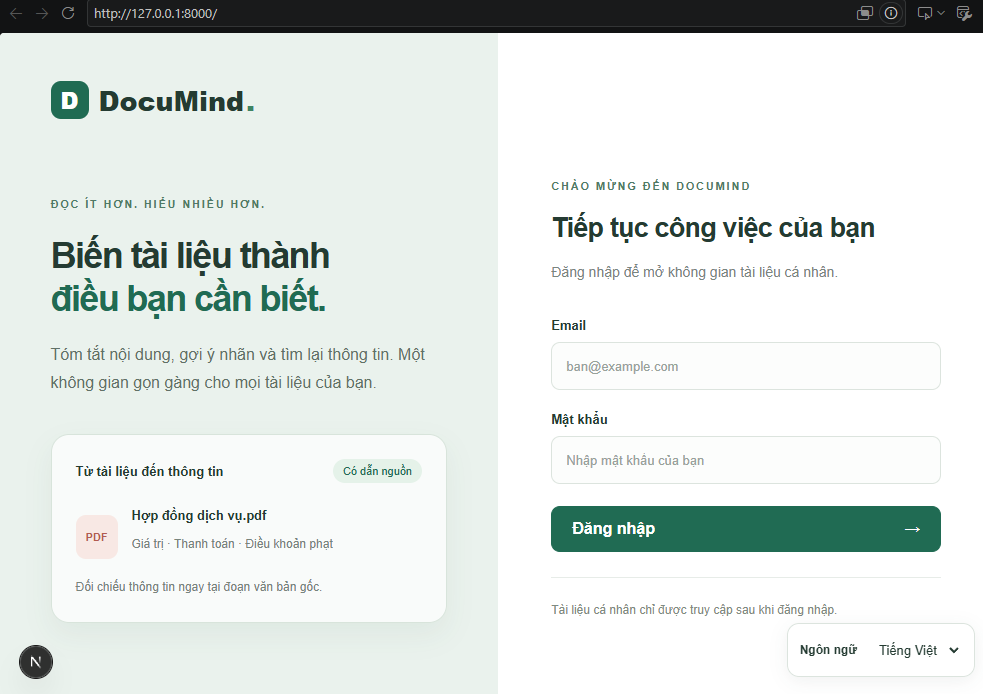

### Workspace - `/workspace`

The user comes here to find owned documents, inspect suggested labels/confidence and search document contents. Document links and search citations open Reader. AI confidence below 80% shows Needs review.

API calls:

- `GET /documents` - Load owned documents.
- `GET /search` - Search document contents.
- `POST /auth/logout` - Sign out.

**Empty:** a filename search has no matching documents and shows an explicit empty result.

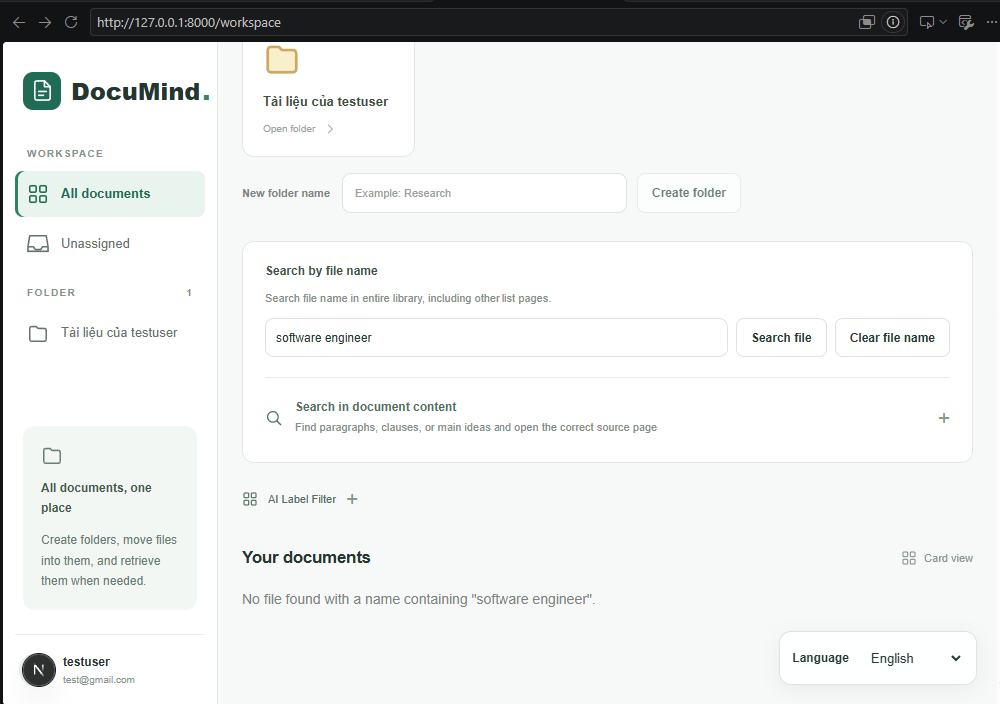

**Loading:** the list displays a loading indicator and placeholder cards while fetching documents.

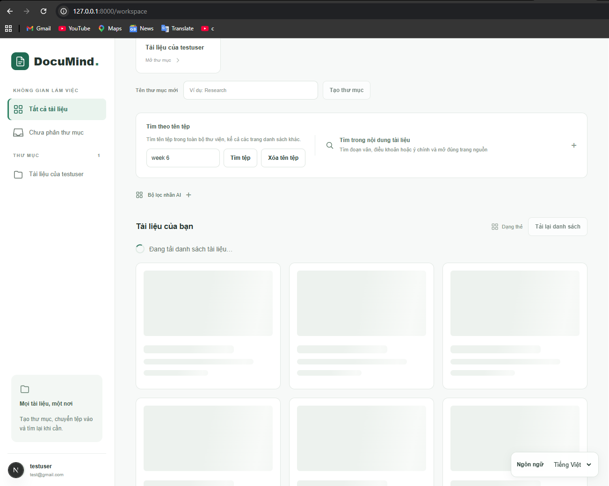

**Error:** a failed document-list request shows the error message and a retry button.

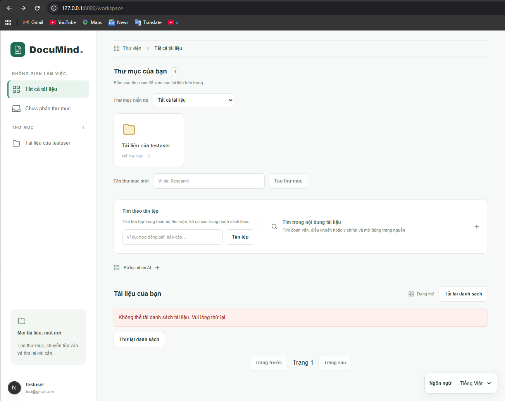

**Data:** document cards display stored filenames, AI labels, confidence and links to open the sources.

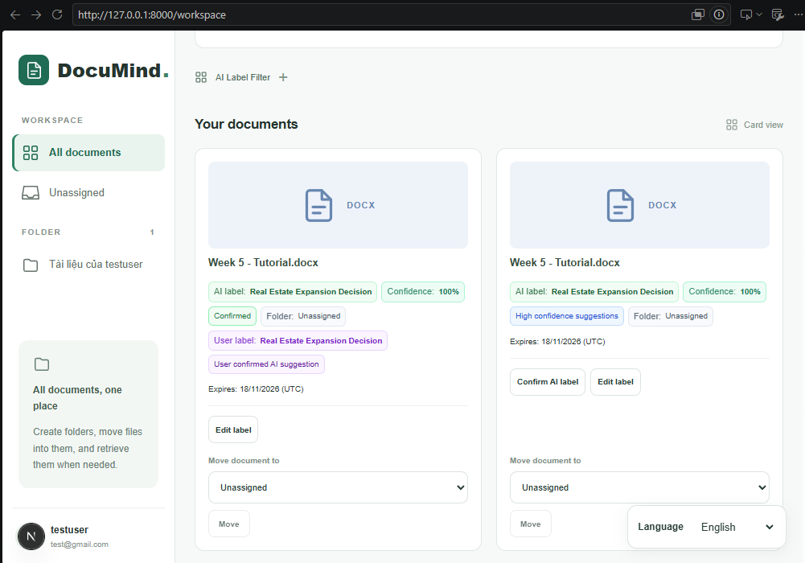

### Upload - `/upload`

The user comes here to choose PDF/DOCX/PPTX files and an analysis mode: table, bullet or concept. Browser validation enforces BR01 before submission. A successful HTTP 202 response supplies `jobId` and opens Results. Invalid selections show per-file messages and remove controls. Upload disables editing while the request is in progress; a failed submission preserves the selection for retry.

API calls:

- `POST /upload` - Validate and submit the selected files for processing.

**Valid selection:** a DOCX file passes the format and size checks.

**Validation error:** an unsupported PNG file is rejected with a format explanation.

### Processing and Results - `/results/:jobId`

The user comes here to follow per-file progress and inspect saved analysis. Results show financial rows, bullets/actions or concepts with source badges. Missing evidence is Unverified. Missing AI configuration is shown explicitly rather than as a generated summary. Mobile financial results use cards.

API calls:

- `GET /jobs/:jobId` - Poll progress and results every three seconds until a terminal state.

**Processing:** job #30 shows a file in progress and a completed-file count of 0/1.

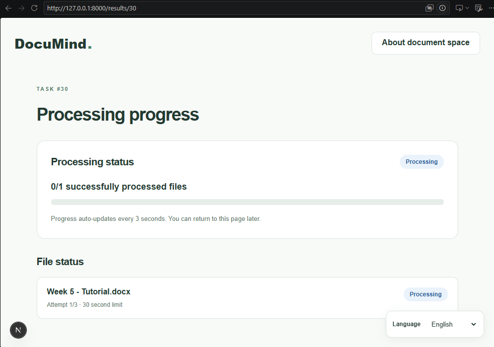

**Completed:** the same job reaches 1/1 and displays Completed.

**Saved summary:** generated bullet points include clickable source-page citations. The captured result is served from cache.

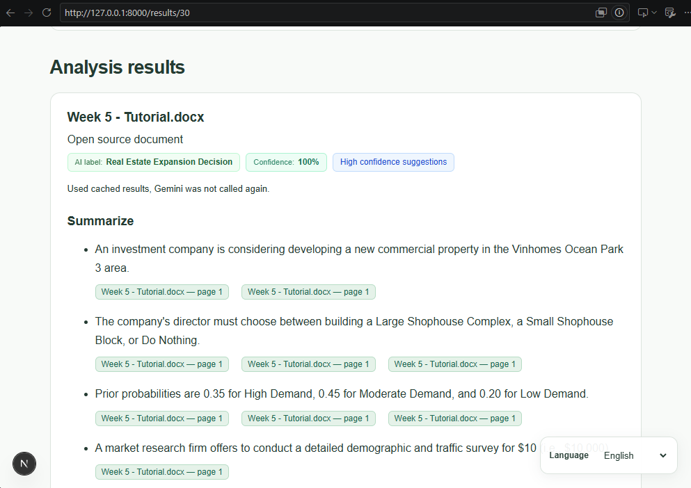

### Document Reader - `/documents/:documentId`

The user comes here to inspect a source page, search text and return to the originating job. Citation query parameters retain page, evidence offsets and the return-job ID.

API calls:

- `GET /documents/:id/pages` - Load page metadata.
- `GET /documents/:id/pages/:page/text` - Read text from a page.
- `GET /documents/:id/reader.pdf?version=...` - Load the reader PDF.
- `GET /documents/:id/summary` - Load the saved summary.
- `GET /documents/:id/file` - Download the original file.
- `POST /documents/:id/reader` - Prepare a missing reader representation.

PDF uses physical source pages. DOCX uses generated text-reader pages rather than original Word pagination. PPTX uses one generated reader page per slide. When exact highlighting is unavailable, the reader explains the limitation; no OCR is provided.

The capture shows a citation from job #30 opened in document 50, with the source passage highlighted on reader page 1.

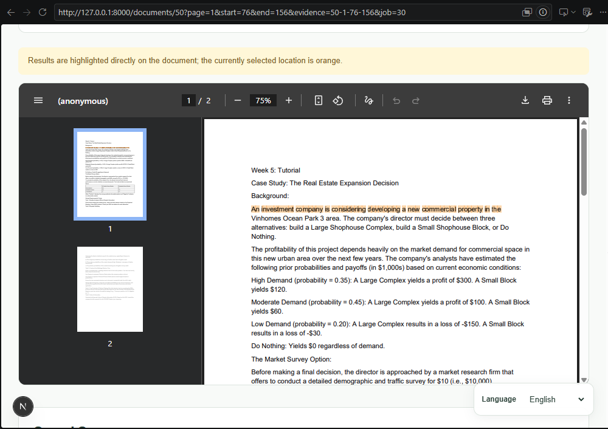

## 3. Error messages

The table provides English translations of the error-message specification in the M3 PDF, using the HTTP codes from the M2 API table and the structured upload codes in design.md. The current upload form still uses the generic retry message for server validation, storage and queue failures; the detailed messages below are the PDF specification.

| API error code | Business rule | The exact message the user sees |
|---|---|---|
| `401` on `POST /auth/login` | BR07 | Incorrect email or password. |
| `422 / files_required` | BR01 | No files selected for upload. Select at least one PDF, DOCX or PPTX file and try again. |
| `422 / too_many_files` | BR01 | The upload exceeds the five-file limit. Remove some files or split them into multiple batches and try again. |
| `422 / invalid_format` | BR01 | This file format is not supported. Select a PDF, DOCX or PPTX file and try again. |
| `422 / file_too_large` | BR01 | The file exceeds 5 MB. Compress or split the document before uploading it again. |
| `422 / batch_too_large` | BR01 | The total file size exceeds 50 MB. Remove some files or split them into multiple batches and try again. |
| `422` unrecognized upload validation | BR01 | The server rejected the upload selection. Check the file formats, sizes, file count and analysis mode, then try again. |
| `500` on `POST /upload` | Upload persistence | Unable to submit the documents because the server could not save the upload. Keep the selected files and try again later. |
| `503` on `POST /upload` | Processing queue | Unable to queue the documents for processing. Please try again later; your selected files remain on the page. |
| Network failure on upload | Upload recovery | Unable to submit the documents. Check your connection and try again. |
| `403` on reader metadata/pages | BR07 | You do not have permission to access this document (Access denied). |
| Failed document-list request | Workspace recovery | Unable to load the document list. Please try again. |

For the BR01 demonstration, sign in, open Upload and select an unsupported file. The English file badge says `Only PDF, DOCX, or PPTX are accepted.`, as shown in the upload-error screenshot. Remove the invalid file to continue. The server repeats validation even if browser checks are bypassed.

## 4. What changed since M2

| Area | M2 baseline | Current interface |
|---|---|---|
| Upload and jobs | Walking skeleton and initial API contract. | Validated batch selection, three analysis modes, saved jobs and per-file progress/failure states. |
| Analysis | Initial data structures and sample results. | Persisted financial comparisons, bullet summaries/actions and concept overviews; Gemini configuration remains server-side. |
| Sources | Document list and basic source references. | Validated evidence, page-specific citations, reader highlighting and return-to-job navigation. |
| Reader | Initial original-file access. | Native PDF extraction and Python-generated DOCX/PPTX text-reader PDFs; no LibreOffice requirement. |
| Workspace | Authenticated document-list skeleton. | Indexed content search, source excerpts, confidence display and in-document lookup. |
| Language and layout | Initial screen designs. | Vietnamese/English controls, saved analysis language and responsive result layouts. |

The running-app evidence is stored in `docs/images/ui/`: `login.png`, `empty.png`, `loading.png`, `error.png`, `Data.png`, `right format.png`, `wrong format.png`, `processing.png`, `complete process.png`, `summary.png` and `citation.png`. The Workspace Data and Upload validation-error captures both include the browser address bar and can be used as the two running-app screenshots on page 3 of the M3 submission.
